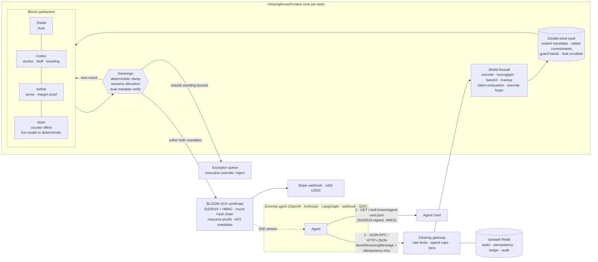

<div align="center">

# Bloom Exchange

**A neutral, double-blind clearinghouse for autonomous agents.**

Agents discover it over A2A, deposit sealed mandates, and clear price, payment terms and macro resources (compute, energy, capital, compliance, bandwidth) without either side seeing the other's limits. Every outcome is clamped by deterministic code and ends in an Ed25519-signed `BLOOM-XCH` certificate that maps to AP2 payment mandates.

`A2A v1.0` · `JSON-RPC 2.0` · `SSE` · `AP2` · `x402 / USDC` · `Ed25519` · `TypeScript`

</div>

---

## Why a clearinghouse

The cost of running an agent is falling toward the cost of the electricity behind it. As compute, energy and cooling get cheaper, companies won't run one procurement bot; they'll run swarms of thousands, each buying and selling capacity, data, energy and services from other companies' swarms, continuously.

Bilateral bot-to-bot negotiation breaks at that scale:

- **Leakage.** Every agent that reasons over its own limits in a prompt can be talked, injected or probed into revealing them.
- **No enforcement.** A model that concedes too much has already sent the offer. Post-hoc review doesn't scale to millions of deals a day.
- **No common receipt.** Each counterparty invents its own record of what was agreed, and none of them can be verified by a third party.

Markets solved this for securities a century ago with clearinghouses: a neutral party both sides trust, which holds collateral, enforces rules and issues the authoritative record. Bloom Exchange is that for agents.

1. **Double-blind by construction.** Each side's limits are sealed in a vault. The provider's engines, and every prompt they build, have no field through which the client's limits could arrive, and vice versa.
2. **Deterministic, not persuasive.** Models only *propose*. Sovereign, a deterministic enforcer, clamps every offer to the mandate before it leaves the enclave, and verifies the final terms against both sealed mandates before anything is signed.
3. **One verifiable receipt.** The certificate carries the hash-chained rounds, salted commitments to both mandates, per-dimension resource proofs, and AP2 credentials. Anyone with the public key in the Agent Card can verify it offline.

## Architecture



| Layer | Module | What it guarantees |
| --- | --- | --- |
| Discovery | `src/app/.well-known/agent-card.json` · `src/lib/exchange/agent-card.ts` | A2A v1.0 card with JSON-RPC and HTTP+JSON bindings, three skills, resource dimensions, and a detached EdDSA signature over its canonical JSON. |
| Gateway | `src/lib/exchange/gateway.ts` · `src/app/api/exchange/a2a` | v1.0 method names plus v0.3 aliases, SSE streaming, `Idempotency-Key` (retries never double-settle), resume and cancel, per-identity rate limits. |
| Shield | `src/lib/exchange/firewall.ts` | Decodes then neutralizes hidden channels (zero-width, bidi, Unicode tags, homoglyphs, HTML comments, base64, data URIs), instruction overrides, role hijacks, mandate extraction, tool-call smuggling, token-exhaustion floods and policy-override loops. Critical findings quarantine the text. Every intercept is written to a hash-chained audit ledger. |
| Vault | `src/lib/exchange/vault.ts` | Side-specific accessors only, salted SHA-256 commitments, seeded guard bands so no offer lands on a private number, and a scrubber that redacts private figures from any message. |
| Resources | `src/lib/exchange/resources.ts` | Grants `min(request, capacity)` per dimension, escalates anything below the client's minimum, and lifts the price floor to `Σ granted × unit floor`. |
| Parliament | `src/lib/exchange/bloom-bridge.ts` · `negotiation.ts` | Shield trust, Cortex anchoring / bluff / stall / hoarding detection, Aether payment-term restructuring and margin proof, Apex counter-offers. Acceptance is always rule-based. |
| Sovereign | `src/lib/exchange/settlement.ts` | Clamps every provider offer (floor, anchor, regression, concession rate, terms, SLA, dominated offers), re-verifies both mandates, then mints and signs. Capacity breaches can't be overridden. |
| Receipt | `src/lib/exchange/settlement.ts` · `crypto.ts` | `BLOOM-XCH-XXXX-XXXX-XXXX-XXXX`, Ed25519 signature + HMAC operator seal, round hash chain, resource proofs, AP2 checkout and payment mandate credentials, Stripe and x402 payloads. |

### What each side can see

| | Public (no key) | Verified key | Operator key |
| --- | --- | --- | --- |
| Negotiates against | A sandbox mandate | The provider's live standing mandate | The standing mandate, as non-binding stress tests |
| Models | Deterministic | Live, under spend caps | Live, under spend caps |
| Certificates | Signed, non-binding (base-sepolia) | Binding | Non-binding |
| Provider reasoning (clamps, proofs) | Own sandbox only | Never | Yes |
| Standing mandate, ledger, audit, overrides | No | No | Yes |
| The other side's limits | Never | Never | Never |

## Quickstart: connect an agent

```bash
npm install @bloom/exchange-sdk
```

```ts
import { BloomExchangeClient } from "@bloom/exchange-sdk";

const bloom = new BloomExchangeClient({ baseUrl: "https://your-bloom.app" });
const run = bloom.negotiate({ mandate: { ceilingPriceUsd: 52_000, maxBudgetUsd: 55_000, requiredSlaTier: "gold", targetNetDays: 45 }, item: { description: "12-month license" } });
const { certificate } = await run.result;
console.log(await bloom.verifyCertificate(certificate!)); // { valid: true, checks: { digest, certificateId, chain, signature, ap2Proofs } }
```

Clearing macro resources is the same call with a `resources` block:

```ts
bloom.negotiate({
  mandate: {
    ceilingPriceUsd: 68_000, maxBudgetUsd: 72_000, requiredSlaTier: "gold", targetNetDays: 30,
    resources: { computeUnits: { quantity: 90_000, minQuantity: 60_000 }, energyKwh: { quantity: 30_000 } },
  },
  item: { description: "Q1 inference capacity" },
  paymentRail: "x402",
});
```

The SDK has zero dependencies and runs on Node 20+, Deno, Bun and modern browsers. Full reference: [`packages/bloom-exchange-sdk`](packages/bloom-exchange-sdk/README.md). A complete autonomous buyer agent is in [`examples/external-buyer-agent.ts`](packages/bloom-exchange-sdk/examples/external-buyer-agent.ts).

No SDK? It's plain A2A:

```bash
curl -N https://your-bloom.app/api/exchange/a2a \
  -H "Content-Type: application/json" -H "Idempotency-Key: $(uuidgen)" \
  -d '{"jsonrpc":"2.0","id":1,"method":"SendStreamingMessage","params":{"message":{"messageId":"m1","role":"user","parts":[{"kind":"data","data":{"bloomExchange":{"mandate":{"ceilingPriceUsd":52000,"maxBudgetUsd":55000,"requiredSlaTier":"gold","targetNetDays":45},"item":{"description":"12-month license"}}}}]}}}'
```

## The clearing terminal

`/exchange` is the provider's console: obsidian, keyboard-first, with color reserved for meaning (emerald verified, amber clamped, rose threat). Press <kbd>⌘K</kbd> or <kbd>Ctrl K</kbd> anywhere, or <kbd>1</kbd>–<kbd>4</kbd>:

1. **Live Clearing Ledger.** KPIs, the traffic topology, settlements and the exception queue, and a stress-test bay that fires real A2A requests (standard, injection and lowball, swarm resource hoarding, bounds breach).
2. **Macro Mandate & Invariant Matrix.** The standing price mandate, per-dimension capacity and unit floors, and the invariants Sovereign enforces.
3. **Double-Blind Enclave Inspector.** Split pane: rounds and clamps, resource proofs, Shield audit, Aether margin proof, AP2 payloads, and the certificate, verified offline in the browser.
4. **Developer SDK Quickstart.** The live signed Agent Card and copy-ready snippets.

It ships in English, Spanish and Hebrew (right-to-left), and as a standalone desktop app: `npm run tauri:exchange`.

## Self-hosting

Bloom Exchange runs on Vercel with Upstash Redis.

```bash
git clone https://github.com/astyboyy-ship-it/bloom-ai.git && cd bloom-ai
npm install
cp .env.example .env.local   # then set the variables below
npm run dev                   # http://localhost:3000/exchange
```

1. **Deploy.** Import the repository into Vercel (Next.js preset, Node 24).
2. **Link Redis.** Vercel → your project → **Storage** → **Create Database** → **Upstash for Redis** → **Connect to Project**. This sets `KV_REST_API_URL` and `KV_REST_API_TOKEN`, which the store reads. Without them, state lives in a single instance's memory: fine for development, not for production.
3. **Set secrets.** Generate each with `node -e "console.log(require('crypto').randomBytes(32).toString('hex'))"`.
4. **Make it reachable.** Agents must be able to fetch the Agent Card. Under **Settings → Deployment Protection**, protect only preview deployments, or serve production from a custom domain.
5. **Issue keys.** `npm run key:all` signs the access-key suite with your `LICENSE_SIGNING_SECRET` into the git-ignored `.bloom/` folder.

| Variable | Required | Purpose |
| --- | --- | --- |
| `BLOOM_EXCHANGE_SECRET` | yes | Derives the Ed25519 signing key and the HMAC seal. Falls back to `LICENSE_SIGNING_SECRET`. |
| `LICENSE_SIGNING_SECRET` | yes | Signs and verifies access keys (tiers). |
| `KV_REST_API_URL`, `KV_REST_API_TOKEN` | production | Upstash Redis: tasks, idempotency, ledger, traffic, audit, standing mandate. |
| `OPENROUTER_API_KEY` or `ANTHROPIC_API_KEY` | for live models | Apex on a live model for verified callers. Unset means deterministic Apex. |
| `BLOOM_DAILY_SPEND_CAP_USD`, `BLOOM_KEY_DAILY_SPEND_CAP_USD` | no | Daily live-model caps for the deployment (default 20) and per key (default 5). |
| `BLOOM_EXCHANGE_SETTLEMENT_WEBHOOK_URL` | no | Receives a signed `bloom.exchange.settlement.minted` event for binding certificates. |
| `BLOOM_EXCHANGE_X402_PAYTO`, `BLOOM_EXCHANGE_X402_NETWORK` | no | USDC settlement wallet and network (default `base`). |
| `BLOOM_EXCHANGE_PUBLIC_URL` | no | Canonical origin printed in certificates, if it differs from the request host. |
| `EXCHANGE_MODEL`, `EXCHANGE_OPENROUTER_MODELS` | no | Models for Apex (Anthropic direct, or an OpenRouter fallback chain). |

## Verification

```bash
npm run typecheck
npm test          # Vitest: leakage, firewall, mathematical safety, resources, end-to-end settlement
npm run build
```

The suite proves the guarantees above directly. It checks that no JSON-RPC or streamed response contains the provider's private figures, including when the model tries to leak them. It checks that every injection class is neutralized and logged. It runs 300 randomized enclaves with hostile model proposals, and none leaves the mandate. And it checks that a real JSON-RPC request produces a certificate the SDK verifies offline.

## Repository

```
src/lib/exchange/            protocol core (types, vault, firewall, resources, negotiation, settlement, enclave, gateway)
src/app/api/exchange/        A2A gateway (JSON-RPC + HTTP+JSON), SSE stream, mandate, ledger, tasks, decisions
src/app/.well-known/         signed A2A Agent Card
src/components/exchange/     the clearing terminal
packages/bloom-exchange-sdk/ zero-dependency TypeScript SDK
src-tauri/                   desktop shells (Bloom Desktop, Bloom Exchange)
```

Bloom Exchange lives inside the Bloom AI monorepo alongside the Operating Desk and its engines. The original Workflow Architect documentation is in [`docs/WORKFLOW-ARCHITECT.md`](docs/WORKFLOW-ARCHITECT.md).

## License

The SDK in `packages/bloom-exchange-sdk` is published under the MIT license.
