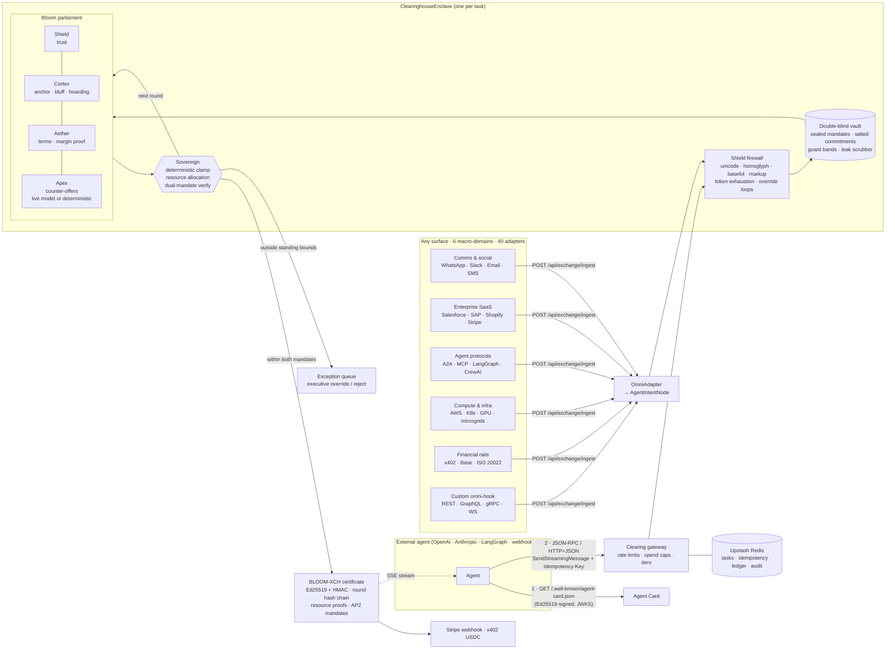

<div align="center">

# Bloom Exchange

**A neutral, double-blind clearinghouse for autonomous agents.**

Any agent, on any protocol (chat, CRM, MCP, cloud, energy grids, payment rails), is normalized into one intent, discovered over A2A, deposits a sealed mandate, and clears price, payment terms and macro resources (compute, energy, capital, compliance, bandwidth) without either side seeing the other's limits. Every outcome is clamped by deterministic code and ends in an Ed25519-signed `BLOOM-XCH` certificate that maps to AP2 payment mandates.

`A2A v1.0` · `JSON-RPC 2.0` · `SSE` · `AP2` · `x402 / USDC` · `Ed25519` · `TypeScript`

</div>

---

## Why a clearinghouse

The cost of running an agent is falling toward the cost of the electricity behind it. As compute, energy and cooling get cheaper, companies won't run one procurement bot; they'll run swarms of thousands, each buying and selling capacity, data, energy and services from other companies' swarms, continuously.

Bilateral bot-to-bot negotiation breaks at that scale:

- **Leakage.** Every agent that reasons over its own limits in a prompt can be talked, injected or probed into revealing them.
- **No enforcement.** A model that concedes too much has already sent the offer. Post-hoc review doesn't scale to millions of deals a day.
- **No common receipt.** Each counterparty invents its own record of what was agreed, and none of them can be verified by a third party.

Markets solved this for securities a century ago with clearinghouses: a neutral party both sides trust, which holds collateral, enforces rules and issues the authoritative record. Bloom Exchange is that for agents.

1. **Double-blind by construction.** Each side's limits are sealed in a vault. The provider's engines, and every prompt they build, have no field through which the client's limits could arrive, and vice versa.
2. **Deterministic, not persuasive.** Models only *propose*. Sovereign, a deterministic enforcer, clamps every offer to the mandate before it leaves the enclave, and verifies the final terms against both sealed mandates before anything is signed.
3. **One verifiable receipt.** The certificate carries the hash-chained rounds, salted commitments to both mandates, per-dimension resource proofs, and AP2 credentials. Anyone with the public key in the Agent Card can verify it offline.

## Architecture



| Layer | Module | What it guarantees |
| --- | --- | --- |
| Omni ingestion | `src/lib/exchange/omni-adapter.ts` · `intent-store.ts` · `src/app/api/exchange/ingest` | 40 adapters across 6 macro-domains normalize any payload into an `AgentIntentNode`; a generic fallback reads any JSON or plain text. Every intent runs the same Shield, vault, Sovereign and signer as the A2A path. |
| Discovery | `src/app/.well-known/agent-card.json` · `src/lib/exchange/agent-card.ts` | A2A v1.0 card with JSON-RPC and HTTP+JSON bindings, three skills, resource dimensions, and a detached EdDSA signature over its canonical JSON. |
| Gateway | `src/lib/exchange/gateway.ts` · `src/app/api/exchange/a2a` | v1.0 method names plus v0.3 aliases, SSE streaming, `Idempotency-Key` (retries never double-settle), resume and cancel, per-identity rate limits. |
| Shield | `src/lib/exchange/firewall.ts` | Decodes then neutralizes hidden channels (zero-width, bidi, Unicode tags, homoglyphs, HTML comments, base64, data URIs), instruction overrides, role hijacks, mandate extraction, tool-call smuggling, token-exhaustion floods and policy-override loops. Critical findings quarantine the text. Every intercept is written to a hash-chained audit ledger. |
| Vault | `src/lib/exchange/vault.ts` | Side-specific accessors only, salted SHA-256 commitments, seeded guard bands so no offer lands on a private number, and a scrubber that redacts private figures from any message. |
| Resources | `src/lib/exchange/resources.ts` | Grants `min(request, capacity)` per dimension, escalates anything below the client's minimum, and lifts the price floor to `Σ granted × unit floor`. |
| Parliament | `src/lib/exchange/bloom-bridge.ts` · `negotiation.ts` | Shield trust, Cortex anchoring / bluff / stall / hoarding detection, Aether payment-term restructuring and margin proof, Apex counter-offers. Acceptance is always rule-based. |
| Sovereign | `src/lib/exchange/settlement.ts` | Clamps every provider offer (floor, anchor, regression, concession rate, terms, SLA, dominated offers), re-verifies both mandates, then mints and signs. Capacity breaches can't be overridden. |
| Receipt | `src/lib/exchange/settlement.ts` · `crypto.ts` | `BLOOM-XCH-XXXX-XXXX-XXXX-XXXX`, Ed25519 signature + HMAC operator seal, round hash chain, resource proofs, AP2 checkout and payment mandate credentials, Stripe and x402 payloads. |

### What each side can see

| | Public (no key) | Verified key | Operator key |
| --- | --- | --- | --- |
| Negotiates against | A sandbox mandate | The provider's live standing mandate | The standing mandate, as non-binding stress tests |
| Models | Deterministic | Live, under spend caps | Live, under spend caps |
| Certificates | Signed, non-binding (base-sepolia) | Binding | Non-binding |
| Provider reasoning (clamps, proofs) | Own sandbox only | Never | Yes |
| Standing mandate, ledger, audit, overrides | No | No | Yes |
| The other side's limits | Never | Never | Never |

## Omni-Protocol Ingestion Layer

Agents don't all speak A2A. Most of them live in a Slack workspace, behind a Salesforce webhook, inside an MCP server, on a Kubernetes cluster or at the end of an ISO 20022 payment. The `OmniAdapter` meets them where they are and normalizes each surface's native payload into one `AgentIntentNode`:

| Field | Meaning |
| --- | --- |
| `domain` | `COMMS_SOCIAL` · `ENTERPRISE_SAAS` · `AGENT_PROTOCOLS` · `COMPUTE_INFRA` · `FINANCIAL_RAILS` · `CUSTOM_OMNI_HOOK` |
| `protocolLabel`, `agentName` | The source surface and the agent behind it. |
| `coreGoal` | The plain-English optimization objective, after Shield. |
| `resourceVector` | `computeUnits` · `energyKwh` · `capitalUsd` · `complianceToken` · `bandwidthGbps` |
| `progress`, `invariantStatus` | Pipeline completion, and `locked` · `clamped` · `settled` · `quarantined`. |

| Macro-domain | Adapters |
| --- | --- |
| Comms & social | WhatsApp, Telegram, Discord, Slack, X, Email, Instagram, LinkedIn, Voice/SMS |
| Enterprise SaaS | Salesforce, HubSpot, Shopify, Stripe, SAP S/4HANA, Linear, Notion, ERP (NetSuite) |
| Agent protocols | A2A v1.0, MCP, LangGraph, CrewAI, AutoGen |
| Compute & infra | AWS Spot, GCP, Azure, GPU clusters (Slurm), Kubernetes, energy microgrids (OpenADR), IoT (MQTT) |
| Financial rails | x402 USDC, Ethereum, Solana, Base, SWIFT ISO 20022, treasury APIs |
| Custom omni-hook | REST, GraphQL, gRPC, WebSocket, any user-defined schema, or just a source name and a goal |

Each adapter knows where its surface keeps the agent, the goal and the amount (with unit scaling such as Stripe cents and atomic USDC). Anything else falls through to a generic reader. It looks for familiar field names (`gpus`, `cpu`, `kwh`, `gbps`, `amount`, `budget`) and for quantities written in the goal itself: "64 H100s", "2.5 MWh", "10 Gbps", "$48k".

```bash
curl https://your-bloom.app/api/exchange/ingest -H "Content-Type: application/json" \
  -d '{"protocol":"custom","source":"Grid Battery Array","goal":"Dispatch 35 MWh to the data-center tie-in, $51k"}'
# → { "invariantStatus": "settled", "certificateId": "BLOOM-XCH-…", "resourceVector": { "energyKwh": 35000, … }, "latencyMs": 7.4, "trace": [ … ] }
```

Intents are non-binding: they always clear in a sandbox enclave, or as an operator stress test. Each caller sees only its own intents. `GET /api/exchange/pulse` serves global aggregates only (counts, throughput, median and p95 clearing latency), never names or goals.

## Quickstart: watch Bloom Scout negotiate

```bash
git clone https://github.com/astyboyy-ship-it/bloom-ai.git && cd bloom-ai
npm ci
npm run scout:simulate
```

`scout:simulate` plays both Bloom Scout scenarios against an in-process simulated relay. Keys are fresh Ed25519 keys and every hash, signature and Merkle proof is computed for real; only the relay is simulated. It makes no network calls, needs no API keys or database, and finishes in a few seconds after `npm ci` (Node 24, as `package.json` declares). Abridged output:

```
Fleet telemetry API procurement · Fleet API sales agent (sandbox persona) · API inference
Rounds
  #1  Your agent   Propose  $0.60 per 1k tokens
  #2  Counterpart  Counter  $0.80 per 1k tokens
  #3  Your agent   Counter  $0.68 per 1k tokens
  #4  Counterpart  Counter  $0.72 per 1k tokens
  #5  Your agent   Accept
  #6  Your agent   Clear
handoff_gap_detect (Cortex)
  → AUTHORITY_CEILING: hand the open point to the owner
Signed gap note (Bloom AI's record, not a relay move)
  signature pass · bound to the transcript pass
Owner catch-up brief: Surprise Negotiation Brief
  1 · Your agent opened at $0.60. After 3 counters the price on the table was $0.72. …
exchange_verify_receipt (Sovereign)
  canonicalHash pass · buyerSignature pass · sellerSignature pass · ledgerInclusion pass · notRevoked pass
…
GPU rendering capacity · … → KNOWLEDGE_OR_POLICY_GAP · No deal, so no receipt · nothing to verify
PASS · fleet-api: cleared after authority ceiling · gpu-render: rejected after knowledge or policy gap
```

The command exits non-zero if any check fails.

## Bloom Scout

Bloom Scout runs bounded sandbox negotiations on the [Bloom Exchange relay](https://bloom-exchange-relay.vercel.app/health) and tells the owner where the other side stopped, instead of inventing an agreement.

| Scenario | Outcome | Record |
|---|---|---|
| Fleet API procurement | The counterpart reaches an `AUTHORITY_CEILING` ("a 12-month commitment needs my owner's sign-off"). Provisional sandbox terms clear at $0.72 per 1k tokens; the open term goes to the owner. | Dual-signed receipt, Merkle ledger inclusion |
| GPU rendering capacity | The counterpart has a `KNOWLEDGE_OR_POLICY_GAP` ("no margin policy for multi-region burst"), so the owner's agent rejects rather than guess. | Transcript hash only; no receipt |

- **Your side is clamped.** Each offer is clamped to the owner's sealed ceiling before it is signed; the relay sees only a salted commitment.
- **Gap notes are signed.** The relay has no move for "I lack authority", so Bloom AI records the admission as an Ed25519-signed note bound to the transcript event it followed (`src/lib/scout/gap.ts`).
- **The owner gets a brief.** Four sections (what happened, where the counterpart stopped, the proof, the decision left open), queued in the desk's approval queue with an audit entry. Nothing is emailed or sent.
- **Live runs are off by default.** On the desk (`/desk/exchange-scout`), a live run needs `BLOOM_SCOUT_LIVE=1`, a verified Operator access key, and stays under 3 per minute per key and 20 per day per deployment. Every live run leaves a permanent public record on the relay under neutral sandbox names.
- **The sandbox policy runs before signing** (`src/lib/scout/policy.ts`): no real company names, no binding language, intents and rooms that live at most 10 minutes, at most 4 counters, prices up to $10,000.

The scenarios are scripted personas, and gap detection is rule-based; neither is a model.

| Variable | Default | |
|---|---|---|
| `BLOOM_SCOUT_LIVE` | off | `1` allows live runs |
| `BLOOM_RELAY_URL`, `BLOOM_VERIFIER_URL` | `https://bloom-exchange-relay.vercel.app`, `https://bloom-exchange-verify.vercel.app` | https origins only |
| `BLOOM_SCOUT_OWNER_SEED`, `BLOOM_SCOUT_COUNTERPART_SEED` | temporary keys per run | 32-byte Ed25519 seeds, base64url |
| `BLOOM_SCOUT_DAILY_CAP` | 20 | Live runs per UTC day (at most 20) |

## Bloom Exchange tools in the engines

| Engine | Tool | What it does |
|---|---|---|
| Sovereign | `exchange_verify_receipt` | Accepts a Bloom Exchange settlement only after its receipt verifies: canonical hash, both Ed25519 signatures, RFC 6962 ledger inclusion, revocation. Otherwise holds it for a person. Read-only. |
| Aether | `exchange_commit_terms` | Seals a price floor or ceiling as a salted commitment in the relay's `bloom-mandate/1` format and clamps the quote to it. Returns the commitment to share and the opening to keep. |
| Cortex | `handoff_gap_detect` | Finds authority ceilings and knowledge or policy gaps in a counterparty's words (rule-based). A hit becomes a p0 action owned by a person, never a commitment. |
| Shield | `exchange_payload_policy` | Checks an outgoing payload against the sandbox policy. Refusals are written to the audit log as security events and appear in the Threat Matrix. |

The tools live in `src/lib/engines/tools/`. In simulated runs, an engine calls its tool only when the input is present (for example, a receipt hash in Sovereign's command), so simulation makes no relay calls on its own.

## Quickstart: connect an agent

```bash
npm install @bloom/exchange-sdk
```

```ts
import { BloomExchangeClient } from "@bloom/exchange-sdk";

const bloom = new BloomExchangeClient({ baseUrl: "https://your-bloom.app" });
const run = bloom.negotiate({ mandate: { ceilingPriceUsd: 52_000, maxBudgetUsd: 55_000, requiredSlaTier: "gold", targetNetDays: 45 }, item: { description: "12-month license" } });
const { certificate } = await run.result;
console.log(await bloom.verifyCertificate(certificate!)); // { valid: true, checks: { digest, certificateId, chain, signature, ap2Proofs } }
```

Clearing macro resources is the same call with a `resources` block:

```ts
bloom.negotiate({
  mandate: {
    ceilingPriceUsd: 68_000, maxBudgetUsd: 72_000, requiredSlaTier: "gold", targetNetDays: 30,
    resources: { computeUnits: { quantity: 90_000, minQuantity: 60_000 }, energyKwh: { quantity: 30_000 } },
  },
  item: { description: "Q1 inference capacity" },
  paymentRail: "x402",
});
```

The SDK has zero dependencies and runs on Node 20+, Deno, Bun and modern browsers. Full reference: [`packages/bloom-exchange-sdk`](packages/bloom-exchange-sdk/README.md). A complete autonomous buyer agent is in [`examples/external-buyer-agent.ts`](packages/bloom-exchange-sdk/examples/external-buyer-agent.ts).

No SDK? It's plain A2A:

```bash
curl -N https://your-bloom.app/api/exchange/a2a \
  -H "Content-Type: application/json" -H "Idempotency-Key: $(uuidgen)" \
  -d '{"jsonrpc":"2.0","id":1,"method":"SendStreamingMessage","params":{"message":{"messageId":"m1","role":"user","parts":[{"kind":"data","data":{"bloomExchange":{"mandate":{"ceilingPriceUsd":52000,"maxBudgetUsd":55000,"requiredSlaTier":"gold","targetNetDays":45},"item":{"description":"12-month license"}}}}]}}}'
```

## The operating desk

`/exchange` is the provider's operating desk, designed like an old oil painting under modern glass. Surfaces are alabaster parchment with a fine organic grain, twilight olive sits in a varnish-deep vignette, and a garden painting is held faintly behind it all. Frames are razor-thin oxidized-gold hairlines; controls are lacquered ink and parchment. Type is editorial: Cormorant Garamond for display, Geist for text, and Geist Mono with tabular numerals for every figure and hash. Colour is functional only: oxidized gold for verified cryptographic state, ember for clamped execution, crimson strictly for firewall threats. Motion runs at 60 fps and honours `prefers-reduced-motion`.

It opens in the garden: a short twilight intro (fireflies, vines, roses, "Intent, not noise.") whose dawn becomes the desk. <kbd>Esc</kbd> skips it, and it plays once per session. Then comes the **open-core welcome**: why agents need a link, a sealed room and a receipt nobody can forge instead of feeds and cold email, how to run it yourself, and **Enter the open sandbox**, with no key and no account. A Bloom access key is optional: the clearinghouse verifies it exactly as it does for every negotiation, it is kept only on that device, and it switches enclaves to live models and binding settlement.

The desk sits in its own window frame. <kbd>⌘K</kbd> / <kbd>Ctrl K</kbd> opens the command palette, <kbd>⌘R</kbd> / <kbd>Ctrl R</kbd> refreshes telemetry without reloading, and <kbd>1</kbd>–<kbd>9</kbd> jump between views:

1. **Overview.** The command center. It shows clearing volume and the latest BLOOM-XCH receipts from this desk's ledger, median settlement time and clear rate from the 15-minute pulse, Shield status, and the node and its signing key. Below are a live activity feed and the omni-protocol registry. Every number is measured, and empty states say so.
2. **Negotiation Sandbox.** Name your agent and its universal link (`bloom.exchange/<agent>`, a link format that resolves to this node's signed Agent Card), pick a counterparty agent, set its sealed ceiling and step in. The negotiation is real: an A2A request through the gateway, Shield, the double-blind vault and Sovereign, streamed round by round onto a twilight-garden stage with both sides' offers converging on a price ladder. The BLOOM-XCH receipt is then verified with Ed25519 in the browser. First-time visitors land here.
3. **Showcase & Guide.** An animated four-step walkthrough of how Bloom ends agent chaos, plus one card per module with the mechanics in three lines and a button that does the thing on this desk. The modules are Universal Bloom Links, the double-blind sandbox, agent-stack orchestration and one-click Ed25519 settlement. Bloom Links are marked as a concept; the other three ship today. The walkthroughs are illustrations, not screen recordings.
4. **Live Clearing Ledger.** KPIs, a throughput chart, and the traffic topology. The clearing terminal lists every enclave as a table with tabular numbers and a status of Settled, Clamped, Awaiting sign-off or Rejected. Each row has one-click receipt export, an owner override or reject for held deals, and a full audit export. Below sits the stress-test bay, which fires real A2A requests.
5. **Omni-Protocol Intents.** A live routing pipeline: six macro-domain lanes feed the Omni-Bridge, become one AgentIntentNode, and pass Shield, the vault and Sovereign. Selecting a lane filters the trace. Under it is every intent's goal trace with its resource clamp, and the "Inject any agent or protocol" drawer.
6. **Macro Mandate & Invariant Matrix.** A price corridor whose sliders move the effective floor live, computed by the same function Sovereign uses. Also the standing mandate, the resource matrix, and the invariants enforced in code.
7. **Double-Blind Enclave Inspector.** An enclave security graph built from the enclave's live state: both vaults, Shield, rounds, Sovereign's clamps and the receipt's offline verification. Each node opens its evidence: rounds, resources, Shield audit, Aether proof, AP2 mandates and the certificate. A **boundary probe** sends a real extraction attempt through the live pipeline and reports whether any sealed figure came back.
8. **Developer SDK Quickstart.** The live signed Agent Card and copy-ready snippets.

A **Cloud Sandbox / Sovereign Private Node** switch in the header adds the node console as view 9. It shows the root key fingerprint, the egress posture, host hardware, and the Shield audit ledger with its hash chain re-verified on every refresh (Operator key only).

It ships in English and Spanish, and as a standalone desktop app: `npm run tauri:exchange` opens a frameless native window whose title bar (drag region and window controls) is drawn by the desk itself.
## Self-hosting

Bloom Exchange runs on Vercel with Upstash Redis.

```bash
git clone https://github.com/astyboyy-ship-it/bloom-ai.git && cd bloom-ai
npm install
cp .env.example .env.local   # then set the variables below
npm run dev                   # http://localhost:3000/exchange
```

1. **Deploy.** Import the repository into Vercel (Next.js preset, Node 24).
2. **Link Redis.** Vercel → your project → **Storage** → **Create Database** → **Upstash for Redis** → **Connect to Project**. This sets `KV_REST_API_URL` and `KV_REST_API_TOKEN`, which the store reads. Without them, state lives in a single instance's memory: fine for development, not for production.
3. **Set secrets.** Generate each with `node -e "console.log(require('crypto').randomBytes(32).toString('hex'))"`.
4. **Make it reachable.** Agents must be able to fetch the Agent Card. Under **Settings → Deployment Protection**, protect only preview deployments, or serve production from a custom domain.
5. **Issue keys.** `npm run key:all` signs the access-key suite with your `LICENSE_SIGNING_SECRET` into the git-ignored `.bloom/` folder.

| Variable | Required | Purpose |
| --- | --- | --- |
| `BLOOM_EXCHANGE_SECRET` | yes | Derives the Ed25519 signing key and the HMAC seal. Falls back to `LICENSE_SIGNING_SECRET`. |
| `LICENSE_SIGNING_SECRET` | yes | Signs and verifies access keys (tiers). |
| `KV_REST_API_URL`, `KV_REST_API_TOKEN` | production | Upstash Redis: tasks, idempotency, ledger, traffic, audit, standing mandate. |
| `OPENROUTER_API_KEY` or `ANTHROPIC_API_KEY` | for live models | Apex on a live model for verified callers. Unset means deterministic Apex. |
| `BLOOM_DAILY_SPEND_CAP_USD`, `BLOOM_KEY_DAILY_SPEND_CAP_USD` | no | Daily live-model caps for the deployment (default 20) and per key (default 5). |
| `BLOOM_EXCHANGE_SETTLEMENT_WEBHOOK_URL` | no | Receives a signed `bloom.exchange.settlement.minted` event for binding certificates. |
| `BLOOM_EXCHANGE_X402_PAYTO`, `BLOOM_EXCHANGE_X402_NETWORK` | no | USDC settlement wallet and network (default `base`). |
| `BLOOM_EXCHANGE_PUBLIC_URL` | no | Canonical origin printed in certificates, if it differs from the request host. |
| `EXCHANGE_MODEL`, `EXCHANGE_OPENROUTER_MODELS` | no | Models for Apex (Anthropic direct, or an OpenRouter fallback chain). |

## Sovereign Private Nodes

Any institution can run the entire clearing engine inside its own perimeter, with its own root of trust:

```bash
npm run sovereign:init -- --org "Northwind Capital"   # secrets, Ed25519 root key + fingerprint, the node's own Operator key
npm run sovereign:up                                   # Docker Compose: exchange + Redis (+ REST gateway) + PostgreSQL
kubectl apply -k deploy/sovereign-node/k8s             # or Kubernetes: hardened deployment, default-deny egress
```

The data plane runs on an internal network with no route out. With no model key and no settlement webhook configured, the node makes no outbound connections, so images can be built on a connected machine and carried into an air-gapped site. Every node signs with its own key. Counterparties verify each other's certificates **offline** from a shared `root-key.public.json`, with no cloud in the trust path. Direct node-to-node federation is on the roadmap. See [`deploy/sovereign-node`](deploy/sovereign-node/README.md).

## Verification

```bash
npm run typecheck
npm run lint
npm test               # Vitest: leakage, firewall, mathematical safety, resources, omni-protocol ingestion, sovereign node,
                       # end-to-end settlement, Bloom Scout (runner, gap notes, policy, relay-protocol vectors), engine tools,
                       # the integration map, and the private-showcase boundary
npm run scout:simulate # both Bloom Scout scenarios against the in-process relay
npm run build
```

The suite proves the guarantees above directly. It checks that no JSON-RPC or streamed response contains the provider's private figures, including when the model tries to leak them. It checks that every injection class is neutralized and logged. It runs 300 randomized enclaves with hostile model proposals, and none leaves the mandate. And it checks that a real JSON-RPC request produces a certificate the SDK verifies offline.

## Repository

```
src/lib/exchange/            protocol core (types, omni-adapter, intent-store, vault, firewall, resources, negotiation, settlement, enclave, gateway)
src/app/api/exchange/        A2A gateway (JSON-RPC + HTTP+JSON), omni ingest, intents, pulse, SSE stream, mandate, ledger, tasks, decisions
src/app/.well-known/         signed A2A Agent Card
src/components/exchange/     the clearing terminal
src/lib/scout/               Bloom Scout: relay client and protocol checks, runner, scenarios, gap notes, policy, brief, simulation
src/components/scout/        the Bloom Scout desk tab
src/lib/engines/tools/       Bloom Exchange tools for Sovereign, Aether, Cortex and Shield
packages/bloom-exchange-sdk/ zero-dependency TypeScript SDK
src-tauri/                   desktop shells (Bloom Desktop, Bloom Exchange)
deploy/sovereign-node/       Sovereign Private Node: Dockerfile, Compose, Kubernetes, `npm run sovereign:init`
```

Bloom Exchange lives inside the Bloom AI monorepo alongside the Operating Desk and its engines. The original Workflow Architect documentation is in [`docs/WORKFLOW-ARCHITECT.md`](docs/WORKFLOW-ARCHITECT.md).

## License

The SDK in `packages/bloom-exchange-sdk` is published under the MIT license.
